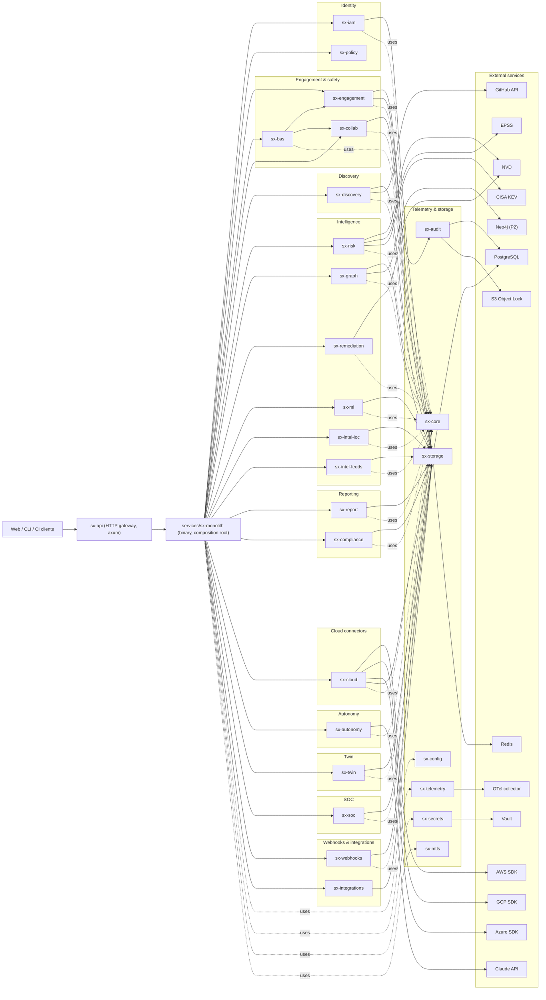

# System Architecture — SentinelX

| Field | Value |
|---|---|
| Document name | ARCHITECTURE-SentinelX |
| Document ID | SX-ARCH-001 |
| Version | 3.0 |
| Status | Approved for Implementation |
| Classification | Internal — Restricted |
| Owner | Principal Architect |
| Reviewers | CTO, CISO, VP Engineering, Principal Platform Engineer, Principal Data Engineer, Director SRE |
| Distribution | Engineering, SRE, Security, Architecture Council |
| Last updated | 2026-06-14 |
| Related documents | [BRD](BRD.md), [PRD](PRD.md), [TRD](TRD.md), [FSD](FSD.md), [RDBMS](RDBMS.md), [SYSTEM_FLOW](SYSTEM_FLOW.md) |

> This document is the single source of truth for the architecture of
> SentinelX. It complements [TRD](TRD.md) (which captures technical
> requirements) and [SYSTEM_FLOW](SYSTEM_FLOW.md) (which captures
> dynamic runtime flows). It is the document a new engineer or external
> reviewer reads to build a mental model of the system.

---

## 0. Architectural Stance

### 0.1 Style: Hexagonal Modular Monolith → Microservice-Ready

SentinelX ships as a **single Rust binary** (`sx-monolith`) composed of
**40 `sx-*` crates** (plus 3 service binaries: `sx-monolith`, `sx-cli`,
`sx-agent`) organised by bounded context. Every cross-domain boundary
is already a Rust trait (port). A future microservice split is a
deployment decision, not a code rewrite. The complete crate inventory
and per-crate role is catalogued in §19.

```
┌─────────────────────────────────────────────────────────────────┐
│                                                                 │
│   ┌─────────────┐                  ┌────────────────────────┐   │
│   │  sx-api     │ ──── trait ────▶ │   AppState (ports)     │   │
│   │  (axum)     │ object call      │   Arc<dyn Trait>        │   │
│   └──────┬──────┘                  └────────────┬───────────┘   │
│          │                                       │              │
│   middleware: auth, rate-limit, trace, CORS      │              │
│          │                                       │              │
│   ┌──────▼───────────────────────────────────────▼───────────┐  │
│   │      Domain crates (hexagonal seams; no I/O)             │  │
│   │                                                          │  │
│   │   sx-iam   sx-engagement   sx-bas   sx-discovery         │  │
│   │   sx-risk  sx-graph        sx-cloud  sx-soc   sx-twin    │  │
│   │   sx-compliance  sx-report  sx-audit  sx-policy          │  │
│   │   sx-intel-{ioc,feeds}  sx-secrets  sx-ml                │  │
│   │   sx-autonomy  sx-webhooks  sx-collab  sx-remediation    │  │
│   │   sx-integrations  sx-mtls  sx-storage  sx-core          │  │
│   └──────────────────────────────────────────────────────────┘  │
│                                                                 │
│  Background jobs (4 default, conditional):                      │
│   • graphsage_job  • drift_job  • continuous_sim                │
│   • intel_feeds_job                                             │
│                                                                 │
└─────────────────────────────────────────────────────────────────┘
```

### 0.2 Architectural Principles

1. **Hexagonal.** Domain crates know nothing of HTTP, Postgres, or
   Tokio. Adapters live in `services/sx-monolith/src/adapters/`.
2. **Composition root.** A single `build_app_state` function assembles
   every adapter. Change wiring there; everything else stays pure.
3. **No `unsafe`.** Workspace `forbid_unsafe`.
4. **Strict clippy.** `deny pedantic + nursery + cargo + unwrap_used +
   expect_used + panic` for non-test code.
5. **Tenant-aware.** Every read filters by tenant from the JWT.
6. **Audit-first.** Every state-changing action emits one audit row.
7. **Safety-by-default.** Two-person rules + kill switches are not
   optional.
8. **Pluggable everything.** Every external system (Postgres, Redis,
   Vault, AWS, Neo4j, OPA, OTel) is reached through a port. Tests use
   stubs.

---

## 1. Logical Architecture (5 Layers)

```
╔══════════════════════════════════════════════════════════════╗
║          Layer 5 — Presentation                              ║
║                                                              ║
║   Next.js 15 dashboard (App Router + Auth.js v5)             ║
║   Swagger UI + API Playground                                ║
║   Operator CLI (sx-cli)                                      ║
║   Postman collection (api/postman.collection.json)           ║
╚══════════════════════════════════════════════════════════════╝
                            ▲
╔═══════════════════════════╪══════════════════════════════════╗
║          Layer 4 — Control & Analysis                        ║
║                                                              ║
║   sx-api (axum 0.7 router)                                   ║
║   middleware: auth, rate-limit, trace, CORS, idempotency     ║
║   AppState (Arc<dyn Trait>)                                  ║
║   sx-risk   sx-graph   sx-compliance   sx-soc                ║
║   sx-autonomy  sx-report                                     ║
╚══════════════════════════════════════════════════════════════╝
                            ▲
╔═══════════════════════════╪══════════════════════════════════╗
║          Layer 3 — Domain Capabilities                       ║
║                                                              ║
║   sx-iam  sx-engagement  sx-bas  sx-discovery  sx-cloud      ║
║   sx-intel-ioc  sx-intel-feeds  sx-remediation  sx-twin      ║
║   sx-ml  sx-webhooks  sx-collab  sx-policy                   ║
╚══════════════════════════════════════════════════════════════╝
                            ▲
╔═══════════════════════════╪══════════════════════════════════╗
║          Layer 2 — Cross-cutting & Adapters                  ║
║                                                              ║
║   sx-storage (Postgres, Redis, in-mem ports + adapters)      ║
║   sx-audit (HMAC chain)                                      ║
║   sx-secrets (Vault Transit DEK)                             ║
║   sx-mtls (server + verifier)                                ║
║   sx-config (figment layered)                                ║
║   sx-telemetry (tracing + OTLP)                              ║
║   sx-core (shared kernel: IDs, errors, timestamps)           ║
╚══════════════════════════════════════════════════════════════╝
                            ▲
╔═══════════════════════════╪══════════════════════════════════╗
║          Layer 1 — Data Plane & External                     ║
║                                                              ║
║   PostgreSQL 15+                                             ║
║   Redis 7+                                                   ║
║   S3 Object Lock (audit anchors + reports + evidence)        ║
║   HashiCorp Vault (KMS DEK)                                  ║
║   AWS SDK / GCP SDK / Azure SDK (cloud inventory)            ║
║   Neo4j (Phase 2 attack graph)                               ║
║   ClickHouse (Phase 2 SOC cold archive)                      ║
║   OTel Collector → Tempo/Jaeger + Prometheus + Loki          ║
╚══════════════════════════════════════════════════════════════╝
```

---

## 2. Dependency Graph (Crate Level)

The following Mermaid graph mirrors the actual `Cargo.toml` workspace
dependency tree. Dotted edges mark shared-kernel imports.



**Notes.**

- Every domain crate depends only on `sx-core` (shared kernel) and the
  ports it owns; never on adapters.
- Every cross-domain call is a trait method, not a concrete struct
  call — this is the seam that enables the future microservice split.

---

## 3. Component Catalogue

### 3.1 Crate-by-Crate Responsibility

| Crate | Layer | Responsibility | Key types |
|---|---|---|---|
| `sx-core` | 2 | Shared kernel: IDs, errors, timestamps | `TenantId`, `EngagementId`, `SxError` |
| `sx-config` | 2 | Layered configuration | `Settings`, `Profile` |
| `sx-telemetry` | 2 | tracing-subscriber + OTLP | `TelemetryInit` |
| `sx-secrets` | 2 | Vault Transit DEK cache | `SecretsClient`, `Dek` |
| `sx-mtls` | 2 | mTLS server + cert verifier | `MtlsLayer`, `CertVerifier` |
| `sx-storage` | 2 | Repository ports + Postgres/Redis/in-mem adapters | `EngagementRepo`, `FindingRepo` (ports) |
| `sx-audit` | 2 | HMAC chain + S3 Object Lock anchor | `AuditChain`, `AuditAnchor` |
| `sx-iam` | 3 | Authn, MFA, RBAC | `JwtClaims`, `Permission`, `MfaSecret` |
| `sx-policy` | 3 | OPA/Rego policy gate | `PolicyGate` |
| `sx-engagement` | 3 | State machine, scope validator | `Engagement`, `Scope`, `Transition` |
| `sx-discovery` | 3 | Passive + agent-less + repo discovery | `DiscoveryRunner` |
| `sx-cloud` | 3 | AWS/GCP/Azure inventory | `CloudConnector`, `Resource` |
| `sx-bas` | 3 | BAS scheduler, kill switch | `BasRun`, `BasResult` |
| `sx-collab` | 3 | OOB collaborator allocation | `OobCollaborator` |
| `sx-intel-ioc` | 3 | Bloom IOC lookup | `IocStore` |
| `sx-intel-feeds` | 3 | TAXII + STIX feed pollers | `FeedPoller` |
| `sx-ml` | 3 | ML triage prediction | `MlPredictor` |
| `sx-remediation` | 3 | Vendor advisory lookup (MSRC, RedHat) | `RemediationFetcher` |
| `sx-twin` | 3 | Scenario engine | `Twin`, `Scenario` |
| `sx-webhooks` | 3 | HMAC-verified inbound | `WebhookVerifier` |
| `sx-integrations` | 3 | Outbound (Slack, Jira, PagerDuty) | `OutboundIntegration` |
| `sx-risk` | 4 | Composite risk scoring | `RiskScorer` |
| `sx-graph` | 4 | Path search + GraphSAGE job | `AttackGraph`, `Path` |
| `sx-compliance` | 4 | Framework catalog + mapper | `Framework`, `Control` |
| `sx-soc` | 4 | Buffered sink + correlator | `SocSink`, `Alert` |
| `sx-autonomy` | 4 | PR proposal + validation scheduling | `RemediationProposal` |
| `sx-report` | 4 | PDF + HTML report renderers | `ReportRenderer` |
| `sx-api` | 4 | HTTP layer + controllers + middleware | `Router`, `AppState` |

### 3.2 Service Catalogue

| Service | Purpose | Binary | Default port |
|---|---|---|---|
| `sx-monolith` | The HTTP server (default deploy unit) | `target/release/sx-monolith` | 18080 (configurable) |
| `sx-cli` | Operator CLI (bootstrap, rotate-keys, audit-tail, tenant-export) | `target/release/sx-cli` | n/a |
| `sx-agent` | Optional asset-side daemon (Phase 2) | `target/release/sx-agent` | n/a |

### 3.3 Dashboard

Next.js 15 (App Router), Auth.js v5 beta, Tailwind v4, TypeScript
strict, Tanstack Table 8, Recharts 3, swagger-ui-dist. Source under
`web/dashboard/`.

---

## 4. Composition Root

### 4.1 `AppState` (Phase 1)

```rust
#[derive(Clone)]
pub struct AppState {
    pub iam: Arc<dyn IamService>,
    pub engagements: Arc<dyn EngagementService>,
    pub assets: Arc<dyn AssetService>,
    pub findings: Arc<dyn FindingService>,
    pub risk: Arc<dyn RiskScorer>,
    pub graph: Arc<dyn AttackGraph>,
    pub bas: Arc<dyn BasScheduler>,
    pub compliance: Arc<dyn ComplianceService>,
    pub cloud: Arc<dyn CloudConnectorRegistry>,
    pub intel: Arc<dyn IntelService>,
    pub soc: Arc<dyn SocSink>,
    pub twin: Arc<dyn TwinEngine>,
    pub audit: Arc<dyn AuditChain>,
    pub reports: Arc<dyn ReportRenderer>,
    pub autonomy: Arc<dyn AutonomyService>,
    pub webhooks: Arc<dyn WebhookVerifier>,
    pub settings: Arc<Settings>,
    pub metrics: Arc<Metrics>,
}
```

### 4.2 `build_app_state`

`services/sx-monolith/src/adapters/mod.rs` exposes a single
`pub fn build_app_state(cfg: &Settings) -> AppState`. Every adapter is
constructed here and only here.

### 4.3 Test Composition

Integration tests build a parallel `AppState` using in-memory adapters
(see `crates/sx-storage/src/in_mem.rs`). This is how the test suite
runs without Postgres or Redis.

---

## 5. Deployment Architecture

### 5.1 Kubernetes Topology (recommended)

```
┌─────────────────────────────────────────────────────────────┐
│ Ingress (Envoy / NGINX) — TLS termination + optional mTLS   │
└─────────────────────────┬───────────────────────────────────┘
                          │
            ┌─────────────┼──────────────┐
            │             │              │
    ┌───────▼────┐  ┌─────▼─────┐  ┌─────▼──────┐
    │ sx-monolith│  │ Dashboard │  │ sx-monolith │
    │   (pod 1)  │  │  (pod 1)  │  │   (pod 2)   │
    └────────────┘  └───────────┘  └─────────────┘
            │             │              │
            └─────────────┼──────────────┘
                          │
    ┌─────────────────────┼──────────────────────┐
    │                     │                      │
┌───▼────┐         ┌──────▼───┐          ┌───────▼─────┐
│ PG HA  │         │ Redis HA │          │ S3 / MinIO  │
│ (RW+RO)│         │ (Sentinel│          │ (Obj Lock)  │
└────────┘         └──────────┘          └─────────────┘

┌────────┐         ┌──────────┐          ┌─────────────┐
│ Vault  │         │ OTel     │          │ Loki +      │
│ HA     │         │ Collector│          │ Tempo +     │
└────────┘         └──────────┘          │ Prometheus  │
                                         └─────────────┘
```

### 5.2 Helm Chart

`deploy/helm/sentinelx/` contains:

- `Chart.yaml` — chart metadata.
- `values.yaml` — production-friendly defaults.
- `templates/` — Deployment, Service, ConfigMap, Secret, HPA,
  PodDisruptionBudget, NetworkPolicy, ServiceMonitor.

### 5.3 Single-Node Deployment

For small customers / on-prem:

```
docker-compose up
```

`docker-compose.yml` brings up `sx-monolith` + Postgres + Redis + MinIO
+ OTel collector on a single host. Suitable for tenants ≤ 1,000 assets.

### 5.4 Air-Gapped Deployment

Sovereign edition ships as:

- `sx-monolith` Rust binary (statically linked, no dynamic deps).
- Postgres + Redis + MinIO container images.
- Air-gap update channel: signed cosign artefacts on USB / portable
  media; receipt verification before install.

### 5.5 Region / Multi-Region

Phase 1: single primary region (Jakarta), DR replica in Singapore.
Phase 2: per-tenant data-residency pinning with regional shards.

---

## 6. Network & Security Architecture

### 6.1 Network Zones

```
                  Internet
                     │
            ┌────────▼────────┐
            │   Edge (WAF)    │  ◀── Cloud WAF (AWS WAF / Cloudflare)
            └────────┬────────┘
                     │ TLS 1.3
            ┌────────▼────────┐
            │ Ingress (k8s)   │  ◀── Optional mTLS for partner APIs
            └────────┬────────┘
                     │ TLS
            ┌────────▼────────┐
            │ Pod network     │
            │ (sx-monolith)   │
            └────────┬────────┘
                     │ TLS
        ┌────────────┼────────────────┐
        │            │                │
┌───────▼──┐  ┌──────▼─────┐  ┌───────▼────┐
│ PG       │  │ Redis      │  │ Vault      │
│ private  │  │ private    │  │ private    │
└──────────┘  └────────────┘  └────────────┘
```

**Egress controls:**

- Outbound to NVD / KEV / EPSS / GitHub via egress proxy (logged).
- Cloud SDK calls limited to customer-supplied roles only.
- BAS sandbox egress whitelist enforced at the network layer.

### 6.2 Identity & Trust

| Identity | Issued by | Used for |
|---|---|---|
| User JWT | sx-iam | API authentication |
| Operator mTLS cert | Internal CA | Operator-only endpoints |
| Service-to-service token | sx-iam | Background jobs lease |
| Webhook signature | Per-integration | Inbound HMAC verify |
| OIDC bearer | Customer IdP | First-leg authn before exchange |

### 6.3 Crypto Boundaries

- TLS 1.3 only (rustls).
- Argon2id for passwords (m=19456, t=2, p=1).
- HMAC-SHA256 for audit chain and webhook signatures.
- AES-256-GCM for column encryption via Vault Transit DEK.
- HS256 for JWT (≥ 32-byte key); migration to RS256 considered for
  Phase 2 federated deployments.

### 6.4 Secret Management

- Vault Transit engine.
- DEK cache in `sx-secrets` with 5-min TTL.
- All `Debug` impls redact (`secrecy::Secret`).
- `zeroize` on drop for symmetric keys.

---

## 7. Data Architecture

### 7.1 Stores

| Store | Use | Persistence | Backup |
|---|---|---|---|
| PostgreSQL 15+ | Primary OLTP | Disk (HA pair RW + RO) | Nightly pg_dump + WAL archive to S3 |
| Redis 7+ | Cache, rate limit, queues, kill-switch pub/sub | RAM + AOF | AOF + RDB snapshot every 6 h |
| S3 Object Lock | Audit anchors, reports, evidence | Object | Cross-region replication |
| Vault 1.15+ | KMS DEK, secrets | Disk (Raft) | Snapshot daily |
| Neo4j (Phase 2) | Attack graph | Disk | Online backup |
| ClickHouse (Phase 2) | SOC cold archive | Disk | Snapshot weekly |

### 7.2 Schema Overview

See [RDBMS.md](RDBMS.md) for full DDL. Key tables:

- `tenant`, `user`, `role`, `permission`, `user_role`, `session`,
  `mfa_secret`.
- `engagement`, `scope`, `engagement_event`.
- `asset`, `discovery_run`, `cloud_account`, `cloud_resource`.
- `finding`, `finding_status_history`, `remediation_link`,
  `finding_compliance`.
- `bas_run`, `bas_approval`.
- `ioc_feed`, `ioc`.
- `audit_event`, `audit_anchor`.
- `soc_event`, `soc_alert`.
- `report`, `autonomy_proposal`, `idempotency_key`,
  `webhook_inbound`.

### 7.3 Partitioning

- `audit_event` monthly RANGE partitions, 7 years retention.
- `soc_event` daily RANGE partitions, 30 days hot.
- `finding` monthly RANGE partitions (Phase 2).

### 7.4 Data Flow Diagram

```
[Client] ──► [API] ──► [Domain service] ──► [Repo port]
                                                  │
                                       ┌──────────┴──────────┐
                                       │                     │
                                       ▼                     ▼
                                 [Postgres adapter]    [In-mem adapter]
                                       │
                                       ▼
                                 [PostgreSQL]
```

---

## 8. Runtime Architecture

### 8.1 Process Model

- Single Tokio multi-thread runtime.
- Worker threads = CPU count.
- Axum tower stack with layered middleware.
- Background jobs as named tokio tasks.

### 8.2 Middleware Stack

```
incoming request
     │
     ▼
request_id (UUID v4 → trace id)
     │
     ▼
opentelemetry layer (extract W3C traceparent)
     │
     ▼
tracing layer (per-route span)
     │
     ▼
CORS layer
     │
     ▼
rate-limit layer (Redis-backed token bucket)
     │
     ▼
auth layer (extract JWT, verify HS256, attach claims)
     │
     ▼
idempotency layer (read-through cache)
     │
     ▼
handler → AppState → trait method
     │
     ▼
audit emit (post-success hook)
     │
     ▼
response envelope
```

### 8.3 Background Jobs

| Job | Crate | Interval | Lease | Toggle |
|---|---|---|---|---|
| `graphsage_job` | `sx-graph` | 15 min | per-tenant Redis lease | `background.graphsage_enabled` |
| `drift_job` | `sx-cloud` | 1 h | per-account lease | `background.drift_threshold ≥ 0.5` |
| `continuous_sim` | `sx-bas` | 60 s | per-engagement lease | `bas.continuous_enabled` |
| `intel_feeds_job` | `sx-intel-feeds` | per-feed | per-feed lease | `intel.feeds.<feed>.enabled` |
| `audit_anchor_job` | `sx-audit` | 1 h | per-tenant lease | always-on in prod |
| `retention_job` | `sx-storage` | 1 d | global lease | always-on |

### 8.4 Worker Pool

- Per-job tokio task; max concurrency configurable.
- Watchdog poll every 500 ms; SIGKILL stale workers after 5 s
  unresponsive.

---

## 9. Performance Characteristics

### 9.1 Latency Budgets

| Endpoint class | Budget (median) | Budget (p99) |
|---|---|---|
| Auth | 80 ms | 400 ms |
| Read (list/get) | 50 ms | 400 ms |
| Write (create/update) | 100 ms | 800 ms |
| Heavy (export, risk recompute) | 500 ms | 5 s |

### 9.2 Throughput

| Endpoint | Sustained | Burst |
|---|---|---|
| API total per node | 5,000 RPS | 10,000 RPS |
| SOC sink per tenant | 5,000 EPS | 20,000 EPS |
| Discovery | 10K assets / 1 h | n/a |

### 9.3 Resource Footprint (per node)

| Resource | Baseline | With 50 tenants |
|---|---|---|
| CPU | 2 vCPU | 8–16 vCPU |
| RAM | 1 GB | 6–10 GB |
| Disk (binary) | 80 MB static | 80 MB |
| Network | < 50 Mbps idle | 200–500 Mbps active |

### 9.4 Scaling Strategy

- **Horizontal:** `sx-monolith` is stateless; scale via k8s HPA on CPU
  or queue length.
- **Vertical:** Postgres primary scaled to 4 vCPU / 16 GB Phase 1, 16
  vCPU / 64 GB by Year 2.
- **Sharding (Phase 3):** per-tenant database for sovereign tenants;
  shared schema with `tenant_id` for SaaS tenants.

---

## 10. Observability Architecture

### 10.1 Three Pillars

| Pillar | Tooling | Endpoint |
|---|---|---|
| Metrics | Prometheus exposition | `GET /metrics` |
| Tracing | OpenTelemetry OTLP gRPC | → collector → Tempo/Jaeger |
| Logs | tracing-subscriber JSON | → Loki |

### 10.2 Metric Inventory

- `http_requests_total{route, method, status}` — counter.
- `http_request_duration_seconds{route, method}` — histogram.
- `findings_total{tenant, severity, status}` — gauge.
- `bas_runs_total{tenant, mode, result}` — counter.
- `audit_rows_total{tenant}` — counter.
- `background_job_runs_total{job, outcome}` — counter.
- `kill_switch_trips_total{tenant}` — counter.
- `discovery_assets_total{tenant, kind}` — counter.

### 10.3 Trace Sampling

- Head-based.
- 1% in prod, 100% in staging.
- Force-sample on errors (`Error` span attribute).

### 10.4 SLO Catalogue

See [`docs/slos.md`](slos.md). Highlights:

- API availability ≥ 99.9% monthly.
- Median latency ≤ 200 ms; p99 ≤ 800 ms.
- Audit anchor success ≥ 99.99% monthly.
- Kill-switch propagation ≤ 5 s p99.

---

## 11. Cross-cutting Concerns

### 11.1 Configuration

Layered: defaults → YAML → env (`SENTINELX__*` with `__` for nesting) →
CLI flags. Example:

```yaml
server:
  bind_addr: "0.0.0.0:18080"
  tls:
    enabled: false
database:
  enabled: true
  url: "postgres://sx:sx@pg:5432/sx"
redis:
  enabled: true
  url: "redis://redis:6379/0"
jwt:
  signing_key: "<base64-32-bytes>"
  access_ttl_secs: 900
  refresh_ttl_secs: 604800
```

### 11.2 Errors

- Domain crates expose `enum Error` (thiserror).
- API layer maps domain `Error` → HTTP status + code per
  [FSD §5.3](FSD.md).

### 11.3 Logging

- JSON structured.
- Span-scoped attributes; PII redaction on `email`, `password`,
  `token`, `secret`, `key`.
- Correlation: `request_id` (ULID) propagated in every span.

### 11.4 Telemetry init

```rust
let tracer = telemetry::init(&cfg.telemetry)?;
let _guard = telemetry::install_subscriber(tracer);
```

The guard handles graceful shutdown.

---

## 12. Quality Attributes

### 12.1 Security Quality

- `forbid_unsafe` workspace.
- Strict clippy deny set (no panics, no unwraps in non-test code).
- `cargo-deny` blocks vulnerable / non-permissive deps.
- `cargo-audit` runs in CI.
- Container images signed via Sigstore cosign.
- STRIDE threat model in `docs/security/threat-model-stride.md`.

### 12.2 Reliability

- Graceful shutdown on SIGTERM.
- Liveness + readiness probes.
- Circuit breakers around external APIs.
- Retry with exponential backoff for transient errors.
- Idempotency for state-changing endpoints.

### 12.3 Maintainability

- Hexagonal seams → swap adapters without domain change.
- Workspace lint enforcement.
- Per-crate `tests/` integration.
- ADR log for design decisions.

### 12.4 Performance Quality

- Criterion benches per hot path.
- Avoid allocations on hot path where possible.
- Use `Arc<...>` for shared immutable state.

### 12.5 Auditability

- Every state-changing API call audit-logged.
- HMAC chain + S3 Object Lock anchor.
- `sx-cli audit verify` for chain integrity.

---

## 13. Architecture Decision Records (ADR)

ADRs live in [`docs/adr/`](adr/). The index below tracks the
foundational decisions:

| ID | Title | Status |
|---|---|---|
| ADR-001 | Rust modular monolith over polyglot microservices for Phase 1 | Accepted |
| ADR-002 | Hexagonal architecture; domain crates own ports | Accepted |
| ADR-003 | Postgres as primary OLTP; Neo4j deferred to Phase 2 | Accepted |
| ADR-004 | JWT HS256 over RS256 for Phase 1 (simpler key mgmt) | Accepted |
| ADR-005 | Argon2id for password hashing | Accepted |
| ADR-006 | HMAC-anchored audit chain + S3 Object Lock | Accepted |
| ADR-007 | OpenTelemetry OTLP over Datadog Agent | Accepted |
| ADR-008 | `forbid_unsafe` workspace | Accepted |
| ADR-009 | Two-person rule + kill switch for BAS | Accepted |
| ADR-010 | Tenant isolation via Postgres `SECURITY DEFINER` | Accepted |
| ADR-011 | Auth.js v5 beta for dashboard auth | Accepted with risk |
| ADR-012 | In-memory attack graph in Phase 1; Neo4j Phase 2 | Accepted |
| ADR-013 | sqlx over diesel for compile-time query check | Accepted |
| ADR-014 | axum over actix-web (tower ecosystem) | Accepted |
| ADR-015 | OTel collector as central tracing hub | Accepted |

---

## 14. Migration Strategy (Monolith → Microservices)

Each microservice split follows a documented cut line:

### 14.1 Cut Lines

| Service candidate | Source crates | Trigger |
|---|---|---|
| `iam-svc` | `sx-iam`, `sx-policy` | Tenant count > 1,000 |
| `engagement-svc` | `sx-engagement`, `sx-bas`, `sx-collab` | BAS load > 100 RPS |
| `discovery-svc` | `sx-discovery`, `sx-cloud` | Discovery > 100 jobs / hour |
| `intel-svc` | `sx-intel-ioc`, `sx-intel-feeds`, `sx-remediation` | Feed volume > 50K events / day |
| `graph-svc` | `sx-graph` (Neo4j backend) | Graph > 10M nodes |
| `soc-svc` | `sx-soc` | SOC > 50K EPS |
| `report-svc` | `sx-report`, `sx-compliance` | Render queue depth > 50 |
| `autonomy-svc` | `sx-autonomy`, `sx-ml` | Proposals > 1K / day |
| `gateway-svc` | `sx-api` | always-on once any service split |

### 14.2 Split Procedure (per service)

1. Promote port trait to a network boundary (gRPC + protobuf).
2. Move adapters into the new service.
3. Leave existing trait calls in the monolith behind a feature flag.
4. Cut over per tenant in a controlled change window.
5. Decommission monolith path after one quarter of stability.

---

## 15. Frontend Architecture

### 15.1 Structure

```
web/dashboard/
├── src/
│   ├── app/                 App Router routes (24 routes)
│   ├── components/          UI primitives + feature components
│   │   ├── ui/              shadcn-style primitives
│   │   ├── tables/          Tanstack Table wrappers
│   │   ├── charts/          Recharts wrappers
│   │   └── feature/         per-page components
│   ├── lib/
│   │   ├── api-client/      typed Fetch wrapper around /api/*
│   │   ├── auth/            Auth.js v5 config
│   │   └── types/           TS types mirrored from OpenAPI
│   └── styles/              Tailwind v4 globals
└── tests/                   Playwright + Vitest
```

### 15.2 Server vs Client Components

- Default to React Server Components (RSC).
- `"use client"` only for stateful UI (forms, dialogs, charts with
  interactivity).
- Server actions for state-changing operations; CSRF protection via
  Auth.js.

### 15.3 Auth Flow

1. User signs in via Credentials or OIDC provider (`/login`).
2. Auth.js v5 session cookie issued.
3. Server actions read session; client never holds the access token
   directly.
4. API client adds `Authorization: Bearer <token>` server-side only.

---

## 16. Compliance Architecture

| Framework | Architecture hook |
|---|---|
| SOC 2 (TSC) | Audit chain + RBAC + change management + DR drill log |
| ISO 27001 | Asset inventory (the platform itself) + risk register + ISMS controls |
| PCI DSS | Storage encryption + segmentation + audit retention |
| NIST CSF | Mapping catalog only (no certification) |
| UU PDP / GDPR | Right-to-erasure (`sx-cli tenant delete`) + data-residency config + DPA |
| FedRAMP (Phase 3) | FIPS 140-2 modules + boundary diagram + continuous monitoring |

---

## 17. Open Architectural Questions

1. **JWT signing migration to RS256** for Phase 2 federated deployments?
   *(Owner: Principal Security Architect.)*
2. **ClickHouse vs TimescaleDB** for SOC cold store? *(Owner: Principal
   Data Engineer.)*
3. **Neo4j vs Memgraph** for attack graph? *(Owner: Principal Platform
   Engineer.)*
4. **NATS JetStream vs Kafka** for inter-service messaging when split?
   *(Owner: Director SRE.)*
5. **WASM-based plugin sandbox** for partner-built modules (Phase 4)?
   *(Owner: CTO.)*
6. **Per-tenant vs per-shard partitioning** for `audit_event` in Year 3?
   *(Owner: Principal Data Engineer.)*

---

## 18. Document Control

| Version | Date | Author | Change summary |
|---|---|---|---|
| 1.0 | 2026-05-29 | Principal Architect | Initial architecture document |
| 2.0 | 2026-06-11 | Principal Architect | Major expansion: full layer model, deployment topology, microservice cut lines, ADR index, frontend architecture |
| 3.0 | 2026-06-14 | Principal Architect | Workspace grown to 40 crates + 3 services. New sections: updated high-level layer diagram (§19), tenant isolation deep-dive (§20), multi-cloud KMS architecture (§21), audit-chain + TSA anchoring architecture (§22), plugin SDK sandbox (§23), SOAR workflow execution (§24), hunt query compile pipeline (§25), threat-model deltas mapping P-tasks to STRIDE categories (§26). |

**Change-control rule:** any change touching §1 (logical
architecture), §2 (dependency graph), §5 (deployment), or §6 (network &
security) requires CTO + CISO sign-off and an ADR.

---

## 19. Updated High-Level Architecture (v3.0)

### 19.1 Eight-module sidebar → ports → adapters → storage

The dashboard's left sidebar groups capability into **eight modules**.
Each module is a slice of the AppState (Arc<dyn Port>), wired through
ports to one or more adapters, terminating in storage.

```
┌──────────────────────────────────────────────────────────────────────────┐
│                              CLIENTS                                     │
│  Browser (Next.js dashboard) │ CLI (sx-cli) │ Mobile (FCM/APNs receiver) │
│  External: SCIM/IdP, TAXII feed, Falco, K8s admission, webhooks           │
└──────────────────────────────────┬───────────────────────────────────────┘
                                   │ HTTPS / mTLS
┌──────────────────────────────────▼───────────────────────────────────────┐
│                     EDGE — sx-api (axum) router                          │
│                                                                          │
│  Middleware stack (in order):                                            │
│   request_id → tracing → CORS → rate-limit (Redis) → auth (JWT)          │
│   → device_trust (P2-008) → idempotency → dlp_egress (P2-006)            │
└──────────────────────────────────┬───────────────────────────────────────┘
                                   │
┌──────────────────────────────────▼───────────────────────────────────────┐
│                  DASHBOARD MODULES — sidebar to ports                    │
│                                                                          │
│ ┌──────────────┐ ┌──────────────┐ ┌──────────────┐ ┌──────────────────┐ │
│ │  IDENTITY    │ │ ENGAGEMENTS  │ │  ASSETS &    │ │   FINDINGS &     │ │
│ │              │ │              │ │  DISCOVERY   │ │   REMEDIATION    │ │
│ │ sx-iam       │ │ sx-engagement│ │ sx-discovery │ │ sx-storage       │ │
│ │ sx-rba       │ │ sx-bas       │ │ sx-cloud     │ │ sx-vuln-ingest   │ │
│ │ sx-scim      │ │ sx-collab    │ │ sx-runtime   │ │ sx-remediation   │ │
│ └──────────────┘ └──────────────┘ └──────────────┘ └──────────────────┘ │
│                                                                          │
│ ┌──────────────┐ ┌──────────────┐ ┌──────────────┐ ┌──────────────────┐ │
│ │  THREAT      │ │  DETECTION   │ │  COMPLIANCE  │ │   AUTOMATION     │ │
│ │  INTEL       │ │  & HUNT      │ │  & EVIDENCE  │ │   & PLUGINS      │ │
│ │ sx-intel-ioc │ │ sx-soc       │ │ sx-compliance│ │ sx-soar          │ │
│ │ sx-intel-    │ │ sx-hunt      │ │ sx-report    │ │ sx-ir-playbooks  │ │
│ │   feeds      │ │ sx-ml/UEBA   │ │ sx-audit     │ │ sx-plugins       │ │
│ │              │ │ sx-graph     │ │              │ │ sx-autonomy      │ │
│ └──────────────┘ └──────────────┘ └──────────────┘ └──────────────────┘ │
│                                                                          │
│  Cross-cutting: sx-policy │ sx-mtls │ sx-secrets │ sx-config │ sx-       │
│                 telemetry │ sx-webhooks │ sx-integrations │ sx-dlp │     │
│                 sx-chaos │ sx-device-trust │ sx-log-ingest               │
└──────────────────────────────────┬───────────────────────────────────────┘
                                   │
┌──────────────────────────────────▼───────────────────────────────────────┐
│                         ADAPTERS (composition root)                      │
│            services/sx-monolith/src/adapters/*.rs                        │
│                                                                          │
│  KekProvider: aws_kms │ gcp_kms │ az_kv                                  │
│  GraphAttackPathsPort: in_mem │ neo4j (neo4rs/Bolt)                      │
│  TaxiiPort: taxii_v21 │ MandiantClient │ CrowdStrikeClient               │
│  VulnIngestPort: openvas │ nessus │ qualys │ prowler                     │
│  LogIngestPort: http │ grpc │ kafka                                      │
│  SamlSpPort: samael │ ScimProvisionPort: scim_service                    │
│  WebauthnPort: webauthn_rs                                               │
│  SoarPort: workflow_executor │ PluginsPort: in_proc_sandbox              │
│  AuditAnchorPort: rfc3161_freetsa │ digicert_tsa │ sectigo_tsa           │
│  MobilePushPort: apns_jwt │ fcm_oauth2                                   │
└──────────────────────────────────┬───────────────────────────────────────┘
                                   │
┌──────────────────────────────────▼───────────────────────────────────────┐
│                              STORAGE                                     │
│                                                                          │
│  ┌────────────┐  ┌────────────┐  ┌────────────┐  ┌──────────────────┐   │
│  │ PostgreSQL │  │ ClickHouse │  │  Redis     │  │  S3 / MinIO      │   │
│  │ FORCE RLS  │  │ events_raw │  │ (optional) │  │  Object Lock     │   │
│  │ multi-tenant│ │ events_norm│  │ kill-sw,   │  │  Compliance mode │   │
│  │            │  │ TTL 30/90d │  │ lockout    │  │  7-yr retention  │   │
│  └────────────┘  └────────────┘  └────────────┘  └──────────────────┘   │
│  ┌────────────┐  ┌────────────┐  ┌────────────┐                          │
│  │  Neo4j     │  │  KMS       │  │  TSA       │                          │
│  │  (opt'l)   │  │  (AWS/GCP/ │  │  (RFC 3161)│                          │
│  │  Bolt      │  │   Azure)   │  │  FreeTSA…  │                          │
│  └────────────┘  └────────────┘  └────────────┘                          │
└──────────────────────────────────────────────────────────────────────────┘
```

### 19.2 Background jobs (revised set)

| Job | Frequency | Source |
|---|---|---|
| `graphsage_job` | hourly | `sx-ml` |
| `drift_job` | 15 min | `sx-cloud` |
| `continuous_sim` | 5 min | `sx-bas` |
| `intel_feeds_job` (TAXII) | per-feed (5 min KEV, 1 h NVD) | `sx-intel-feeds` |
| `cve_master_job` (NVD/KEV/EPSS) | hourly | `sx-intel-feeds` |
| `audit_anchor_job` (RFC 3161) | hourly | `sx-audit` |
| `evidence_collect_job` | nightly | `sx-report` |
| `ueba_baseline_job` | nightly | `sx-ml` |
| `bloom_rebuild_job` | nightly | `sx-intel-ioc` |
| `remediation_outcome_job` | hourly | `sx-remediation` |
| `compliance_evidence_job` | per-framework cadence | `sx-compliance` |
| `mobile_push_dedupe_gc` | 5 min | `sx-integrations` |

---

## 20. Tenant Isolation Deep-Dive

Tenant isolation is the platform's #1 invariant. The architecture
enforces it at four layers:

### 20.1 Database — PostgreSQL FORCE ROW LEVEL SECURITY

Every multi-tenant table has:

```sql
ALTER TABLE <table> ENABLE ROW LEVEL SECURITY;
ALTER TABLE <table> FORCE ROW LEVEL SECURITY;

CREATE POLICY tenant_isolation ON <table>
  USING (tenant_id = current_setting('app.current_tenant_id')::uuid)
  WITH CHECK (tenant_id = current_setting('app.current_tenant_id')::uuid);
```

`FORCE` means even the table owner (the app DB user) cannot bypass.

**Tenant context tx.** `sx-storage::with_tenant` opens a transaction
and runs `SET LOCAL app.current_tenant_id = $1`. Every repository call
operates inside such a tx — there is no read path that does not first
set this GUC. The helper signature:

```rust
pub async fn with_tenant<T, F>(
    db: &Db,
    tid: TenantId,
    f: F,
) -> Result<T, StorageError>
where
    F: for<'a> FnOnce(&'a mut TenantTx) -> BoxFuture<'a, Result<T, StorageError>>;
```

The `TenantTx` type is a phantom-marker around `sqlx::Transaction` so
the type system refuses any repo call that takes a raw `&Db`. Cross-
tenant test patterns in §20.4 confirm the enforcement.

### 20.2 Graph — Neo4j parameterisation

`Neo4jKnowledgeGraph` adapter never builds queries by string
concatenation. The tenant filter is bound as a parameter
`{tenant_id: $tid}` in every node match clause and every
relationship match clause. Code review checklist for new graph
queries requires the reviewer to confirm `$tid` is present in **every**
`MATCH` (in/out edges, paths) — the linter `crates/sx-graph/src/lint.rs`
greps for missing `$tid` in `.cypher` files at build time.

### 20.3 Application — `TenantTx` phantom typing

Repository methods take `&TenantTx` (NOT `&Db`). The `TenantTx` is
constructed only inside `with_tenant`, which sets the GUC first. A
handler that "forgets" to enter a tenant tx cannot compile against the
repos. This makes tenant isolation an **API-shape invariant**, not a
runtime check.

### 20.4 Cross-tenant test patterns

In `crates/sx-storage/tests/cross_tenant.rs`:

- Seed two tenants A, B with N findings each.
- For each repository method:
  - Enter tx as A, list/get/update: assert all rows are A.
  - Enter tx as A, attempt to read B's `finding_id` directly: assert
    `NotFound`.
  - Enter tx as B, count rows where `tenant_id = A`: assert 0.
- Repeat for Neo4j (live container) and ClickHouse (parameterised
  queries; the hunt-compile path is the single point of truth, see §25).

These tests run on every PR; failure is a release-blocking SEV-1.

---

## 21. Multi-Cloud KMS Architecture

### 21.1 KEK lookup

```
                           ┌──────────────────┐
                           │  AppConfig       │
                           │  kek.provider =  │
                           │  "aws-kms" |     │
                           │  "gcp-kms" |     │
                           │  "az-kv"         │
                           │  kek.key_uri =…  │
                           └────────┬─────────┘
                                    │
                  on startup ──────▼──────
                  build KekProvider Arc<dyn>
                                    │
┌───────────────────────────────────┴───────────────────────────────────┐
│                                                                       │
│ tenant read path:                                                     │
│                                                                       │
│  1. Repo loads encrypted column → WrappedDek{cipher, ctx, version}    │
│  2. Cache lookup: dek_cache[(tenant_id, dek_version)]                 │
│      hit  → use plaintext DEK from cache (TTL 5 min, capped 256)      │
│      miss → kek.unwrap_dek(wrapped, ctx) → store in cache             │
│  3. Decrypt application data with DEK (AES-GCM-256, nonce in row)     │
│  4. Zeroize DEK on cache eviction                                     │
│                                                                       │
└───────────────────────────────────────────────────────────────────────┘
```

### 21.2 DEK wrapping (write path)

```
plaintext payload ──┐
                    ▼
       AES-GCM-256 encrypt with DEK_v ──▶ ciphertext + nonce + tag
                    │
                    └── DEK_v wrapped by KEK_v at provision time
                        (WrappedDek persisted once per tenant, per
                         version; rotation creates v+1)
```

### 21.3 Encryption context binding

| Provider | AAD vehicle | Value |
|---|---|---|
| AWS KMS | `EncryptionContext` map | `{"tenant_id":<uuid>, "dek_version":<int>}` |
| GCP Cloud KMS | `additionalAuthenticatedData` | `tenant_id\|dek_version` (lossless) |
| Azure Key Vault | AES-GCM AAD | `tenant_id\|dek_version` |

A mismatch on unwrap = `KekError::ContextMismatch` = SEV-1 page +
`audit:secrets.kek_context_mismatch` row.

### 21.4 Failover & migration

```
config.kek.providers = [aws-kms, gcp-kms]   # priority order

on unwrap:
  for provider in providers:
    if WrappedDek.provider_hint matches or unset:
      try unwrap → return on success
  return Unavailable

on wrap: always use providers[0] (primary).
```

The `provider_hint` field on `WrappedDek` lets a migration window
co-exist: old DEKs decrypt via AWS, new ones encrypt via GCP. Migration
job re-wraps each tenant's DEKs in batches.

---

## 22. Audit Chain + TSA Anchoring Architecture

### 22.1 Hash-chain construction

```
       tenant scope: per (tenant_id) chain
       advisory_lock(audit_chain, tenant_id) held during insert

  ┌─────────────────┬────────────┬─────────────┐
  │  prev_hash      │  payload   │  hash       │
  │  (32 B)         │  (jsonb)   │  (32 B)     │
  └─────────────────┴────────────┴─────────────┘
  hash = sha256( prev_hash || canonical_json(row_without_hash) )

  Canonicalisation: RFC 8785 JCS (deterministic field order, no
  whitespace, no NaN/Infinity).
```

### 22.2 Merkle tree per anchor period

```
     audit rows in [last_anchor, now] : r0, r1, r2, … rN
                              │
                              ▼
         Build SHA-256 binary Merkle tree, last leaf duplicated
         if N is odd (Bitcoin convention).
                              │
                              ▼
                       Merkle root M (32 B)
```

### 22.3 RFC 3161 TimeStampReq / TimeStampResp flow

```
SX audit anchor job                                  TSA (FreeTSA)
       │                                                  │
       │  TimeStampReq { messageImprint = M, nonce, certReq }
       ├──────────────────  POST  ──────────────────────▶│
       │  Content-Type: application/timestamp-query        │
       │                                                  │
       │                                                  │ verify+sign
       │                                                  │
       │  TimeStampResp { status, timeStampToken }         │
       │◀──────────────────────────────────────────────────┤
       │  Content-Type: application/timestamp-reply        │
       │                                                  │
       │  Verify:                                         │
       │   1. status == granted                           │
       │   2. tsa cert chain valid (trust anchors)        │
       │   3. messageImprint == M                         │
       │   4. nonce == request nonce                      │
       │   5. genTime within ±2 h of local clock          │
       │                                                  │
       │  Persist audit_anchor {merkle_root, tsa_token,   │
       │                       tsa_serial, tsa_time,      │
       │                       chain_end_id}              │
```

Failover order: FreeTSA → DigiCert → Sectigo. Anchor lag SLO:
`sx_audit_anchor_lag_seconds <= 3600`.

### 22.4 Broken-chain detection

Two paths:

- **Real-time.** Every insert recomputes `hash` from the row it's
  about to write; mismatch with caller-supplied value (impossible
  unless the row was edited mid-flight) raises an error.
- **Periodic.** `sx-cli audit verify` walks rows; emits first index
  where `hash != sha256(prev_hash || canonical_json(row))`. If any
  *anchored* range fails, SEV-1 — implies tamper (since the TSA proves
  M existed at time T).

### 22.5 Replay over verified rows

`AuditReplayPort::replay` walks rows; emits `verified=false` for any
row outside an anchored window (so consumers can choose to drop / show
warning).

---

## 23. Plugin SDK Sandbox Architecture

### 23.1 Capability model

```
┌─────────────────────────────────────────────────────────────┐
│  Plugin manifest (signed by SX root, JSON):                 │
│  {                                                          │
│    "name": "snyk-importer",                                 │
│    "version": "1.2.3",                                      │
│    "entrypoint": "main",                                    │
│    "capabilities": [                                        │
│      "read_finding",                                        │
│      "emit_audit",                                          │
│      "http_outbound(api.snyk.io)",                          │
│      "read_secret(snyk_api_key)"                            │
│    ],                                                       │
│    "signature": "<ed25519 sig>"                             │
│  }                                                          │
└─────────────────────────────────────────────────────────────┘
                          │
                          ▼ load: PluginsPort::load(manifest)
                          ▼
                  Verify Ed25519 sig
                          ▼
                  Resolve capabilities → CapabilitySet
                          ▼
                  Register host-function table:
                    fn read_finding(id) -> ...   [if cap present]
                    fn emit_audit(payload)       [if cap present]
                    fn http_outbound(req)        [if cap matches host]
                    fn read_secret(key)          [if cap matches key]
                          ▼
                  Sandbox holds (handle, caps, host_table)
```

Phase 1 sandbox is in-process — capabilities are enforced by which
host functions are populated in the dispatch table (an absent
capability = `PluginError::CapabilityDenied`). Phase 4 candidate:
WASM (`wasmtime`) with linear-memory isolation. The signing model and
manifest schema are forward-compatible.

### 23.2 HMAC-signed outbound webhooks

When a plugin fires an outbound webhook (via the granted
`http_outbound` capability):

```
payload         = json(plugin_response.body)
ts              = unix epoch
nonce           = 16 random bytes
sig_input       = ts || nonce || sha256(payload)
sig             = hmac_sha256(per_tenant_webhook_secret, sig_input)

headers:
  X-SX-Timestamp: <ts>
  X-SX-Nonce:     <hex(nonce)>
  X-SX-Signature: <hex(sig)>
```

Recipients verify by recomputing. Replay window: ±5 min on ts.

---

## 24. SOAR Workflow Execution Architecture

### 24.1 Workflow graph compilation

```
   Authored workflow (YAML/JSON)
                │
                ▼
   Parse → WorkflowGraph { nodes: Vec<Node>, edges: Vec<Edge> }
                │
                ▼
   Validate:
     - all node IDs unique
     - no cycles  (DFS; reject with WorkflowError::CycleDetected)
     - all referenced action_kinds exist in ActionExecutor registry
     - all branch conditions parseable
                │
                ▼
   Topological sort → schedule order
                │
                ▼
   Persist (workflow_definitions table)
```

### 24.2 Run-time scheduler

```
TriggerEvent (manual / cron / webhook / detection)
                │
                ▼
        WorkflowRun row inserted (status = Running)
                │
                ▼
   for each node in topo order:
        if all predecessors completed AND
           (branch_condition is None or evaluates true):
            ActionExecutor.execute(node.kind, node.args, ctx)
              ▶ ActionResult { status, output, side_effects }
            persist NodeRun
        else:
            mark Skipped
                │
                ▼
   when all leaves reach terminal state:
        WorkflowRun.status = Succeeded | PartiallyFailed | Failed
        emit audit:soar.workflow.complete
```

### 24.3 ActionExecutor registry

```rust
trait ActionExecutor: Send + Sync {
    fn kind(&self) -> &'static str;
    async fn execute(&self, args: serde_json::Value, ctx: ActionCtx)
        -> Result<ActionResult, ActionError>;
}
```

Registered executors:

- `slack.send_message`, `slack.create_channel`
- `teams.send_message`
- `jira.create_issue`, `jira.update_issue`
- `pagerduty.trigger`, `pagerduty.resolve`
- `github.open_pr`, `github.add_comment`
- `aws.tag_resource`, `aws.disable_iam_user`
- `sx.create_finding`, `sx.close_finding`, `sx.run_playbook`
- `http.request` (capability-gated host allowlist)

### 24.4 Conditional branching

Branch nodes carry a CEL-style expression evaluated against
`{trigger, prior_outputs}`:

```
if: "outputs.lookup.severity == 'CRITICAL' && trigger.event_type == 'detection'"
then: <node_id>
else: <node_id>
```

Source: `crates/sx-soar/src/{workflow,graph,executor}.rs`.

---

## 25. Hunt Query Compile Pipeline

### 25.1 Stages

```
   raw query text (KQL / SPL-lite, e.g.
     "Authentication | where user == 'alice' and outcome == 'failure' | summarize count() by source_ip")
                │
                ▼
   Lexer (sx-hunt::parser) → tokens
                │
                ▼
   Parser → AST (typed: Source, Where, Project, Summarize, OrderBy, Limit)
                │
                ▼
   Validate:
     - source allowed (Authentication / NetworkActivity / ProcessActivity / …)
     - all referenced fields exist in OCSF schema
     - aggregations well-typed
                │
                ▼
   Compile to parameterised ClickHouse SQL.
   The compiler ALWAYS injects WHERE tenant_id = {tid:UUID} at the
   outermost SELECT. This is enforced by a compile-time check; absent
   predicate is unit-tested per AST shape.
                │
                ▼
   Bind parameters (caller-supplied values are bound separately, never
   string-concatenated; ClickHouse parameter binding via {name:type}).
                │
                ▼
   Execute → rows (BoxStream)
                │
                ▼
   Project to HuntResult (column metadata + Vec<Row>)
                │
                ▼
   audit:hunt.query (action, sql_template_hash, row_count, duration_ms)
```

### 25.2 Adversarial inputs

The parser rejects raw SQL, ClickHouse system functions, file()
sources, and `INTO OUTFILE`. The "compile" stage cannot emit anything
outside the templated shape:

```sql
SELECT {projected_columns}
FROM   {validated_source}
WHERE  tenant_id = {tid:UUID}
       {AND <user-supplied predicates with parameter binding>}
{GROUP BY …} {ORDER BY …} {LIMIT n}
```

### 25.3 Source modules

- `crates/sx-hunt/src/parser.rs` — Pest grammar.
- `crates/sx-hunt/src/ast.rs` — typed AST.
- `crates/sx-hunt/src/compile.rs` — AST → parameterised SQL.
- `crates/sx-hunt/src/clickhouse.rs` — execute + project.

---

## 26. Threat Model Deltas (P-tasks → STRIDE)

Each P-task hardens specific STRIDE categories. This map is the
quick-reference for security review.

| P-task | Capability | Spoofing | Tampering | Repudiation | Info-disclosure | DoS | Elevation |
|---|---|---|---|---|---|---|---|
| P0-001 | TAXII ingest | ▲ |   | ▲ |   |   |   |
| P0-002 | Vuln-ingest | ▲ |   |   |   |   |   |
| P0-003 | Log-ingest |   |   | ▲ |   | ▲ |   |
| P0-004 | SAML SP | ▲▲ | ▲ |   |   |   | ▲ |
| P0-005 | SCIM | ▲ |   |   |   |   |   |
| P0-006 | CVE master |   |   |   | ▲ |   |   |
| P1-001 | Neo4j graph |   |   |   | ▲▲ |   | ▲ |
| P1-002 | WebAuthn | ▲▲ |   |   |   |   | ▲ |
| P1-003 | RBA | ▲▲ |   |   |   |   |   |
| P1-004 | Compliance evidence |   |   | ▲▲ |   |   |   |
| P1-005/6/7 | KEK providers |   | ▲▲ |   | ▲▲ |   |   |
| P1-009 | Prowler import |   |   |   | ▲ |   |   |
| P1-010 | Blast radius |   |   |   |   |   |   |
| P1-011 | Remediation outcomes |   |   | ▲ |   |   |   |
| P1-013 | Commercial intel |   |   |   |   |   |   |
| P1-014 | Risk tuning |   |   |   |   |   | ▲ |
| P1-015 | RFC 3161 TSA anchor |   | ▲▲ | ▲▲ |   |   |   |
| P2-004 | Cloud drift |   | ▲ | ▲ |   |   |   |
| P2-005 | UEBA | ▲ |   |   |   |   | ▲ |
| P2-006 | DLP |   |   |   | ▲▲ |   |   |
| P2-007 | Impossible travel | ▲▲ |   |   |   |   |   |
| P2-008 | Device trust | ▲ |   |   |   |   | ▲ |
| P2-009 | GRC export |   |   | ▲ |   |   |   |
| P2-012 | Chaos admin |   |   |   |   | ▲ |   |
| P2-013 | DAST |   |   |   |   |   |   |
| P2-014 | K8s admission |   | ▲ |   |   |   | ▲▲ |
| P2-015 | BAS chain |   | ▲ | ▲ |   | ▲ |   |
| P2-016 | Falco ingest |   | ▲ | ▲ |   |   | ▲ |
| P3-002 | Chat-ops | ▲ |   |   | ▲ |   |   |
| P3-004 | IR playbooks |   |   | ▲ |   |   |   |
| P3-005 | SOAR |   | ▲ | ▲ |   |   | ▲ |
| P3-006 | Hunt |   |   | ▲ | ▲▲ |   |   |
| P3-007 | Plugins |   | ▲ |   | ▲ |   | ▲▲ |
| P3-008 | Mobile push | ▲ |   |   | ▲ |   |   |
| P3-009 | Audit replay |   |   | ▲▲ |   |   |   |
| P3-010 | Bug bounty | ▲ |   |   |   |   |   |

Legend: ▲ = mitigates; ▲▲ = primary mitigation.

The matrix is reviewed every quarter alongside the pentest report.
Any gap row (capability shipped without ≥1 STRIDE coverage on its
primary risk axis) is a release blocker.

---

## 27. 2026-06 Architecture Deltas (TOP5 + FOUND-001 + QC waves)

This section captures the architecture-level changes landed since the
last refresh (main `6a182a8`). Source-of-truth for the wave-by-wave
status is [`docs/SPRINT_HARDENING_HANDOFF.md`](SPRINT_HARDENING_HANDOFF.md);
the per-feature plans (TOP5-#1 XMLDSig, TOP5-#5 incident sinks,
FOUND-001 finding-write seam, the SSRF guard) live under
[`docs/plans/`](plans/) and the relevant ADRs are catalogued in §13
and below.

### 27.1 New crates

#### 27.1.1 `sx-xmlsec`

Layer 2 (cross-cutting). The FFI scaffold for the staged replacement
of the hand-rolled SAML XMLDSig verifier in `sx-iam` with `libxmlsec1`.
Owns ~24 hand-written `extern "C"` bindings to libxmlsec1 / libxml2 /
OpenSSL-engine symbols (gated behind the `xmlsec1` Cargo feature so
workspace-default builds stay green without the system package), plus
three composable verifier shapes:

* The canonical `XmlDsigVerifier` trait — the `verify(&self, doc:
  &[u8], cfg: &SamlSpConfig) -> Result<VerifyOutcome, XmlSecError>`
  surface every SAML SP and shadow-mode dispatcher implements.
* `LayeredVerifier` — composes the Rust-side byte-level `pre_parse_gates`
  (multi-Assertion XSW, DOCTYPE/DTD, transform allow-list,
  Reference-URI binding, deprecated-algo, single-Signature,
  embedded-X.509 hygiene) with any inner verifier, so the C library
  never sees an XSW-shaped or DOCTYPE-laden document.
* `DualVerifier` — shadow-mode dispatcher that runs both verifiers on
  the same input, returns the *primary* result, and emits
  `xmldsig.shadow.mismatch.<kind>` tracing events plus the
  `xmldsig_shadow_mismatch_total{kind}` Prometheus counter on
  disagreement. Three mismatch kinds: `both_accept_differ`,
  `primary_only_accept`, `secondary_only_accept`.

ADR-0022 covers the rationale and cutover SLO; ADR-0010 records the
superseded hand-rolled decision.

#### 27.1.2 `sx-integrations`

Layer 3 (capability). Outbound integrations + the TOP5-#5 ticketing /
alerting framework. Five families:

* `siem` (Splunk HEC, Syslog/CEF UDP), `chat` (Slack, Teams),
  `grc` (Vanta, Drata, ServiceNow), `bugbounty` (HackerOne, Bugcrowd
  bridge), `jira` (Jira Cloud REST for findings) — pre-existing
  surfaces.
* `incident_sink` — the new pluggable `IncidentSinkPort` framework
  with the shared event / receipt / error taxonomy. Five reference
  vendor adapters land alongside it: `jira_incident` (Jira Cloud
  REST v3), `pagerduty` (Events API v2), `opsgenie` (Alerts API v2),
  `servicenow` (Table API), `linear` (GraphQL `IssueCreate`). Every
  bearer / token credential and webhook URL is wrapped in
  `secrecy::SecretString`; redaction is enforced by per-type `Debug`
  impls.

The crate is `#![forbid(unsafe_code)]` and is wired through the
composition root via the `IncidentSinkPort` fan-out described in
§27.2.

### 27.2 New ports / observer traits

#### 27.2.1 `FindingRepositoryPort::insert`

FOUND-001. Adds a service-internal write surface to the existing
`FindingRepositoryPort`. The contract (full text in
[`crates/sx-api/src/port.rs`](../crates/sx-api/src/port.rs) at the
trait docstring): `insert(&self, view: FindingView) -> Result<FindingView, EngagementPortError>`,
idempotent on `(tenant_id, view.id)` (Postgres adapter uses
`INSERT … ON CONFLICT (id) DO NOTHING`; in-memory adapter mirrors
the same semantics), not exposed through any public HTTP route, and
consumed by emitters that materialise synthetic findings inside the
platform (audit-chain break detector, log-ingest rate limiter,
SAML attack observer, RBA-block translator, cloud-drift watcher).
Rationale is captured in [ADR-0023](adr/0023-finding-repository-insert.md).

#### 27.2.2 `IncidentSinkPort`

TOP5-#5. Observer-style port in `sx-integrations::incident_sink`. The
SAML attack observer, audit-break observer, and RBA-block translator
each fan-out into an optional `Arc<dyn IncidentSinkPort>` after the
`FindingRepositoryPort::insert` call completes. Sink emission is
fire-and-forget from the emitter's perspective: an
`IncidentSinkError::RetryableUpstream` is logged but never blocks
the `insert` (otherwise an outage at Jira would back-pressure SAML
sign-in). Five vendor adapters live in `sx-integrations` (Jira /
PagerDuty / Linear / Opsgenie / ServiceNow).

#### 27.2.3 `BreakObserver`

`sx-audit::BrokenChainSubscriber` (aliased `BreakObserver` in the
composition root) is the trait the chain-verifier calls when it
detects a broken hash chain. The monolith's `MonolithBreakObserver`
adapter (`services/sx-monolith/src/adapters/audit_break_observer.rs`)
translates each break into a `FindingView`, calls
`FindingRepositoryPort::insert`, and fans out to the configured
`IncidentSinkPort` chain. Idempotency is delegated to the port —
re-detection of the same break collapses on `(tenant_id, view.id)`.

#### 27.2.4 `SamlAttackObserver`

`sx_iam::service::saml::SamlAttackObserver`. Notified by the SAML SP
on every detected attack class (XSW variants 1-8, XEE, replay,
signature-stripped, transform-abuse, …). The monolith's
`MonolithSamlAttackObserver` adapter
(`services/sx-monolith/src/adapters/saml_attack_observer.rs`) maps
the typed `SamlAttackEvent` to a `FindingView`, deterministically
derives the finding id from `(tenant_id, kind, calendar-day)` so
bursts collapse on the FOUND-001 idempotency key, and fans out to
the `IncidentSinkPort` chain.

#### 27.2.5 `XmlDsigVerifier`

`sx_xmlsec::XmlDsigVerifier`. The unifying trait under which the
hand-rolled verifier, the libxmlsec1 verifier, the layered (pre-parse-gate
+ inner) verifier, and the shadow-mode dual verifier all sit. The
SAML SP receives `&dyn XmlDsigVerifier` and is agnostic to which
shape it holds. The composition root selects per `saml.xmldsig.verifier`
(see §27.4).

#### 27.2.6 `HttpHeaderScannerPort`

Pre-existing read/list shape gains a `get(tenant_id, scan_id)` method
backing the new `GET /v1/scans/{id}.sarif` route (TOP5-#3-P2-SARIF-API).
Tenant isolation is enforced inside the adapter so the SARIF export
cannot bypass row-level scoping.

### 27.3 New `sx-core::reference::*` modules

Nine enrichment tables + the SSRF guard live under
`crates/sx-core/src/reference/`. Each enrichment table is a pure
function from a raw signal payload to an enriched `FindingView`
skeleton (so the controller/observer keeps stamping responsibility
and `sx-core` keeps its zero-I/O posture):

| Module | Purpose |
|---|---|
| `header_enrichment` | Security-headers scan results (`POST /v1/scans/http-headers`) into `FindingView`. |
| `api_dast_enrichment` | API-DAST scanner findings (`sx-discovery`) into enriched views. |
| `cspm_enrichment` | Cloud security-posture findings from Prowler / `sx-cloud`. |
| `dlp_enrichment` | DLP signals from `sx-dlp` into `FindingView`. |
| `webapp_enrichment` | Web-app DAST results (`POST /v1/discovery/dast/scan`). |
| `saml_attack_enrichment` | `SamlAttackEvent` → `FindingView` (consumed by `MonolithSamlAttackObserver`). |
| `rba_block_enrichment` | RBA-policy block decisions → `FindingView`. |
| `log_ingest_enrichment` | Log-ingest rate-limit decisions → `FindingView`. |
| `audit_enrichment` | Audit-chain break detections → `FindingView`. |

The SSRF guard (`sx-core::reference::url_guard::validate_scan_target`)
is the single source of truth for "is this URL safe to scan from
inside the monolith". It runs *after* the controller-layer
`validate_target` cheap allow-list and performs DNS resolution +
per-IP policy (scheme allow-list, loopback / link-local / cloud-metadata
deny, deliberate RFC 1918 + RFC 4193 *allow*). Rationale and full
threat-model writeup are in [ADR-0024](adr/0024-ssrf-guard.md).

### 27.4 Cross-cutting changes

#### 27.4.1 Composition-root verifier factory (`saml.xmldsig.verifier`)

`build_app_state` now consults a YAML knob `saml.xmldsig.verifier`
with wire-stable tokens `handrolled` / `shadow` / `xmlsec1`. The
`verifier_factory` in `sx-iam` constructs the corresponding
`Arc<dyn XmlDsigVerifier>`; the SAML SP receives it via
`with_verifier(...)` and calls `verify_assertion_with_verifier(&dyn
XmlDsigVerifier)` on every ACS POST. Default is `handrolled`; the
cutover SLO (zero shadow-mode Class A/B disagreements for 14
consecutive days) is the operational gate before flipping to
`xmlsec1` per ADR-0022.

#### 27.4.2 Workspace fmt baseline (M3-FU1)

The workspace `rustfmt.toml` baseline was reconciled with the
landed code; all crates pass `cargo fmt --check` on CI.
**Operational note**: `cargo fmt --workspace` must NOT be run
ad-hoc — it touches generated SQLx caches that ship in-tree, which
in turn forces a workspace-wide rebuild. The CI gate is the
authoritative formatter.

#### 27.4.3 Workspace clippy debt cleanup (LOW-009 + FU1)

Ambient lint debt from the rustc-1.92 MSRV bump was cleared across
`sx-dlp`, `sx-hunt`, `sx-intel-feeds`, `sx-rba`, and `sx-secrets`
in a single sweep. The workspace clippy baseline (`deny pedantic +
nursery + cargo + unwrap_used + expect_used + panic` for non-test
code) is now clean on rustc-1.92.

#### 27.4.4 `audit-toml` policy doc reference (LOW-001 + FU tree)

The supply-chain runbook ([`docs/runbooks/supply-chain.md`](runbooks/supply-chain.md))
§7 catalogues every `cargo audit` ignore entry plus the FU-tree
follow-up tasks. §8 (new) catalogues the libxmlsec1 CVE tracking
sources outside `cargo audit` and the hot-config rollback playbook
for the XMLDSig migration.

### 27.5 Cross-references

* New ADRs: [ADR-0023](adr/0023-finding-repository-insert.md),
  [ADR-0024](adr/0024-ssrf-guard.md).
* Updated ADRs: [ADR-0022](adr/0022-saml-xmldsig-libxmlsec1-replacement.md)
  (supersedes [ADR-0010](adr/0010-saml-xmldsig-handrolled.md)).
* System flows added in [`SYSTEM_FLOW.md`](SYSTEM_FLOW.md) §43
  (finding-emission via FOUND-001), §44 (SAML shadow-mode
  verification), §45 (HTTP-headers scan with SSRF guard).

---
